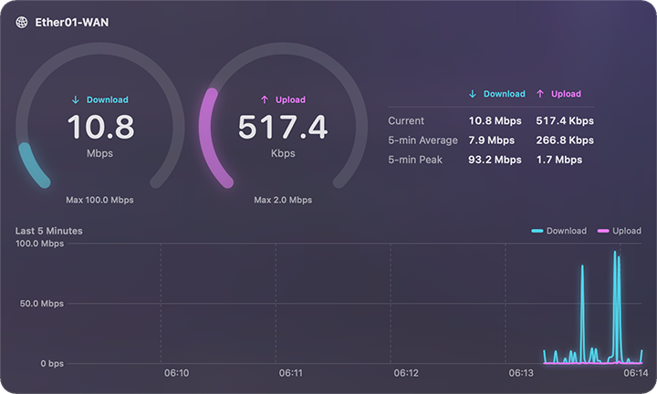

# Anemobit

[English](README.md) | [繁體中文](README.zh-TW.md) | **日本語** | [한국어](README.ko.md)

Anemobit は、SNMP（v2c または v3）でデバイスのインターフェイスのトラフィックをリアルタイムに表示します。標準の IF-MIB と 64 ビットのインターフェイスカウンタに対応したデバイスであれば使用できます。macOS、iOS / iPadOS、Windows、Linux の各プラットフォームにネイティブアプリがあります。

  

## 機能

- 1つ以上のインターフェイスのダウンロード速度とアップロード速度をリアルタイムに表示。インターフェイスごとにゲージと過去5分間のグラフ
- 現在の速度、5分間平均、5分間ピーク
- 指定した1つのインターフェイスの速度を常に表示：メニューバー（macOS）、フローティングウインドウとシステムトレイ（Windows）、システムトレイとトップバー（Linux）
- SNMPv2c、および認証（MD5、SHA1、SHA224、SHA256、SHA384、SHA512）と暗号化（DES、AES-128）に対応した SNMPv3（Windows 版は SHA224 に非対応）
- デバイスをスキャンしてインターフェイスを検出し、名前で選択
- 速度は bit（Mbps）または byte（MB/s）で表示。1、5、10秒ごとに更新
- community と SNMPv3 のパスワードはシステムの安全な保存領域に保存
- 英語、繁体字中国語、日本語、韓国語。既定ではシステムの言語に従い、設定で選ぶこともできます
- 分析、広告、トラッキングはありません。接続するのは入力したデバイスだけです

## スクリーンショット

| iOS | Windows | Linux |
|:-:|:-:|:-:|
|  |  |  |

## ダウンロード

| プラットフォーム | 動作環境 | ダウンロード |
|---|---|---|
| macOS | macOS 27 | Mac App Store（近日公開）・[GitHub Releases](https://github.com/Noctqira/Anemobit/releases) の DMG |
| iOS / iPadOS | iOS 27 / iPadOS 27 | App Store（近日公開） |
| Windows | Windows 11（x64 または ARM64）、[.NET 10 Desktop Runtime](https://dotnet.microsoft.com/download/dotnet/10.0) が必要 | [GitHub Releases](https://github.com/Noctqira/Anemobit/releases) の MSI インストーラ |
| Linux | Ubuntu 26.04 または Fedora 44（x86_64 または ARM64） | [GitHub Releases](https://github.com/Noctqira/Anemobit/releases) の .deb / .rpm |

## デバイスの設定

Anemobit は、デバイスの SNMP エージェントからインターフェイスのカウンタを読み取ります。設定方法はデバイスによって異なるため、詳しくはデバイスの説明書を参照してください。

1. **SNMP を有効にする**：デバイスで SNMP を有効にします（SNMP エージェント、SNMP サービスなどと呼ばれます）。
2. **セキュリティを選ぶ**：
   - **SNMPv2c**：community 名を設定します。初期値の `public` は使わないでください。
   - **SNMPv3**：ユーザを作成し、認証プロトコルとパスワードを設定します。必要に応じて暗号化プロトコルとパスワードも設定します。パスワードは8文字以上です。
3. **アクセスを制限する**：読み取り専用で十分です。デバイスが対応していれば、Anemobit を実行するコンピュータやスマートフォンからの SNMP 要求だけを受け付けるようにします。
4. **通信を許可する**：デバイスのファイアウォールで、ローカルネットワークからの SNMP（UDP ポート 161）を許可します。

次に Anemobit の設定を開き、デバイスのアドレスと同じセキュリティ設定を入力し、インターフェイスをスキャンして監視するものを選びます。デバイスは IF-MIB の 64 ビットカウンタ（`ifHCInOctets` / `ifHCOutOctets`）に対応している必要があります。

## ソースからのビルド

各プラットフォームは、それぞれのネイティブツールで個別にビルドします：

| フォルダ | プラットフォーム | 技術 | ビルド手順（英語） |
|---|---|---|---|
| `Darwin/` | macOS、iOS / iPadOS | Swift + SwiftUI | [Darwin/README.md](Darwin/README.md) |
| `Windows/` | Windows | C# + WPF（.NET 10） | [Windows/README.md](Windows/README.md) |
| `Linux/` | Linux | Rust + GTK4 + libadwaita | [Linux/README.md](Linux/README.md) |

## ライセンス

Anemobit は [Apache License 2.0](LICENSE) でライセンスされています。Copyright © 2026 Noctqira（[NOTICE](NOTICE) を参照）。「Anemobit」の名称とアイコンはライセンスの対象外です。改変版を配布する場合は、別の名称とアイコンを使用してください。ほかに変更が必要な箇所は、各プラットフォームの README に記載しています。

プライバシーポリシー：[PRIVACY.md](PRIVACY.md)
