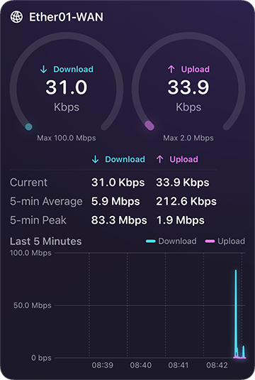
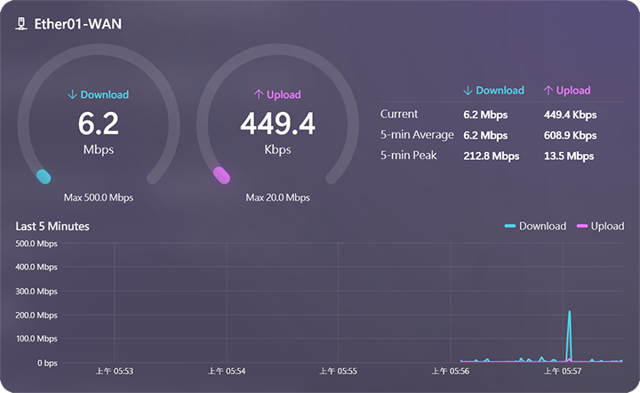
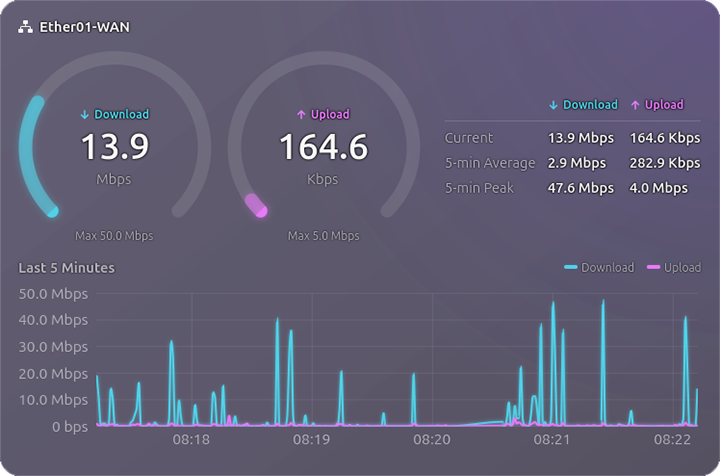

# Anemobit

[English](README.md) | **繁體中文** | [日本語](README.ja.md) | [한국어](README.ko.md)

Anemobit 透過 SNMP（v2c 或 v3）即時顯示設備介面的流量，任何支援標準 IF-MIB 與 64 位元介面計數器的設備都能使用。每個平台各有一套原生 app：macOS、iOS / iPadOS、Windows 與 Linux。

  

## 功能

- 即時顯示一個或多個介面的下載與上傳速率，每個介面都有儀表與最近 5 分鐘的圖表
- 目前速率、5 分鐘平均、5 分鐘峰值
- 指定一個介面的速率常駐顯示：menu bar（macOS）、浮動視窗與系統匣（Windows）、系統匣與頂列（Linux）
- SNMPv2c，以及含認證（MD5、SHA1、SHA224、SHA256、SHA384、SHA512）與加密（DES、AES-128）的 SNMPv3（Windows 版不支援 SHA224）
- 掃描設備找出介面，以名稱選擇
- 速率可用 bit（Mbps）或 byte（MB/s）顯示，每 1、5 或 10 秒更新
- community 與 SNMPv3 密碼存在系統的安全儲存區
- 英文、繁體中文、日文、韓文，預設跟隨系統語言，也可以在設定中選擇
- 沒有分析、廣告或追蹤功能，只連線到你輸入的設備

## 截圖

| iOS | Windows | Linux |
|:-:|:-:|:-:|
|  |  |  |

## 下載

| 平台 | 系統需求 | 下載 |
|---|---|---|
| macOS | macOS 27 | Mac App Store（即將推出）· [GitHub Releases](https://github.com/Noctqira/Anemobit/releases) 的 DMG |
| iOS / iPadOS | iOS 27 / iPadOS 27 | App Store（即將推出） |
| Windows | Windows 11，x64 或 ARM64，需安裝 [.NET 10 Desktop Runtime](https://dotnet.microsoft.com/download/dotnet/10.0) | [GitHub Releases](https://github.com/Noctqira/Anemobit/releases) 的 MSI 安裝程式 |
| Linux | Ubuntu 26.04 或 Fedora 44，x86_64 或 ARM64 | [GitHub Releases](https://github.com/Noctqira/Anemobit/releases) 的 .deb / .rpm |

## 設備端設定

Anemobit 透過設備的 SNMP 代理讀取介面計數器。各廠牌設備的設定方式不同，詳細步驟請參考設備的說明文件。

1. **啟用 SNMP**：在設備上開啟 SNMP（常見名稱為 SNMP agent 或 SNMP 服務）。
2. **選擇安全設定**：
   - **SNMPv2c**：設定 community 名稱，不要使用預設的 `public`。
   - **SNMPv3**：建立使用者，設定認證協定與密碼，需要時再設定加密協定與密碼。密碼至少 8 個字元。
3. **限制存取**：唯讀權限即可。設備支援的話，只接受執行 Anemobit 的電腦或手機發出的 SNMP 請求。
4. **允許連線**：設備的防火牆要允許區域網路的 SNMP 連線（UDP port 161）。

接著在 Anemobit 開啟設定，輸入設備位址與相同的安全設定，掃描介面後選擇要監控的介面。設備必須提供 IF-MIB 的 64 位元計數器（`ifHCInOctets` / `ifHCOutOctets`）。

## 從原始碼建置

各平台以自己的原生工具獨立建置：

| 資料夾 | 平台 | 技術 | 建置說明（英文） |
|---|---|---|---|
| `Darwin/` | macOS、iOS / iPadOS | Swift + SwiftUI | [Darwin/README.md](Darwin/README.md) |
| `Windows/` | Windows | C# + WPF（.NET 10） | [Windows/README.md](Windows/README.md) |
| `Linux/` | Linux | Rust + GTK4 + libadwaita | [Linux/README.md](Linux/README.md) |

## 授權

Anemobit 以 [Apache License 2.0](LICENSE) 授權，版權 © 2026 Noctqira（見 [NOTICE](NOTICE)）。「Anemobit」名稱與圖示不在授權範圍內，散佈修改過的版本時，請使用不同的名稱與圖示。其他需要修改的地方列在各平台的 README。

隱私權政策：[PRIVACY.md](PRIVACY.md)
